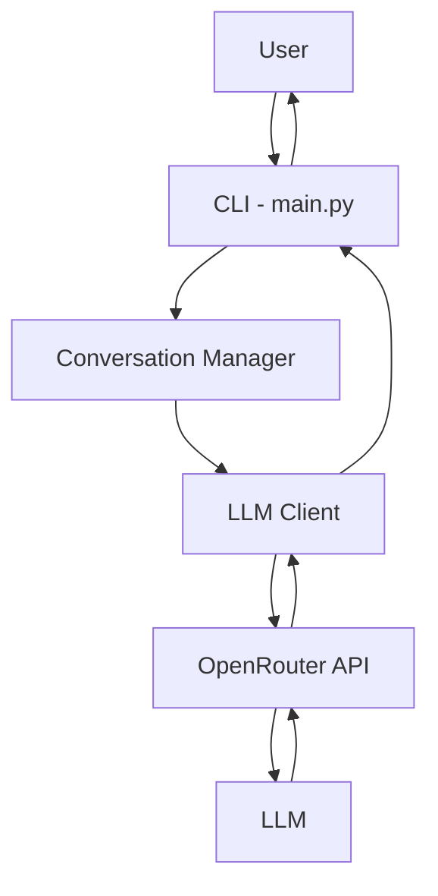

# AI CLI Assistant

A command-line AI assistant built with Python and the OpenRouter API. This is Week 1 of my 52-week AI Engineering learning journey.

The project focuses on understanding how an AI application communicates with an LLM, manages conversation history, and streams responses to users.

## Features

- Connects to an LLM through the OpenRouter API.
- Supports continuous multi-turn conversations.
- Maintains conversation history during a session.
- Streams AI responses as they are generated.
- Supports `/clear` to reset the conversation.
- Supports `/exit` to close the application.
- Loads API credentials from environment variables.

## Architecture



### Main components

| Component | Responsibility |
|---|---|
| `main.py` | Runs the application and handles the conversation loop |
| `conversation.py` | Stores and manages conversation messages |
| `llm_client.py` | Sends requests to OpenRouter and handles streaming |
| `cli.py` | CLI-related functionality |

## Technologies

- Python
- Requests
- python-dotenv
- OpenRouter API
- Git and GitHub

## Project structure

```text
week-01-cli-ai-assistant/
├── README.md
├── requirements.txt
├── .env.example
├── src/
│   ├── __init__.py
│   ├── main.py
│   ├── cli.py
│   ├── conversation.py
│   └── llm_client.py
└── tests/
    ├── test_conversation.py
    └── test_llm_client.py
```

## Getting started

### 1. Clone the repository

```bash
git clone https://github.com/firaol20/ai-engineering-lab.git
```

### 2. Navigate to the project

```bash
cd ai-engineering-lab/quarter-1-foundations/week-01-cli-ai-assistant
```

### 3. Create a virtual environment

```bash
python -m venv .venv
```

### 4. Activate it

PowerShell:

```powershell
.venv\Scripts\Activate.ps1
```

Git Bash:

```bash
source .venv/Scripts/activate
```

### 5. Install dependencies

```bash
pip install -r requirements.txt
```

### 6. Configure environment variables

Copy `.env.example` to `.env` and add your own OpenRouter API key.

Example `.env` configuration:

```env
OPENROUTER_API_KEY=your_openrouter_api_key_here(you can get the api from openrouter for free)
OPENROUTER_MODEL=nvidia/nemotron-3.5-lightning:free
```

**Important:** Never commit your `.env` file or expose your API key.

### 7. Run the assistant

From the project directory:

```bash
python -m src.main
```

## Available commands

| Command | Description |
|---|---|
| `/clear` | Clears conversation history while preserving the system prompt |
| `/exit` | Exits the assistant |

## Testing

Run the conversation manager test:

```bash
python -m tests.test_conversation
```

Run the LLM client integration test:

```bash
python -m tests.test_llm_client
```

The LLM client test requires a valid API key and an internet connection.

## Concepts learned

Through this project, I explored:

- Large Language Models (LLMs)
- AI application architecture
- APIs and HTTP requests
- JSON request and response formats
- Prompt engineering
- System prompts and user messages
- Conversation history and context windows
- Environment variables and API key security
- Streaming responses
- Error handling
- Modular Python application design

## Current limitations

- Conversation history exists only while the application is running.
- Conversations are not saved to a database or local file.
- The assistant does not yet use external tools or autonomous agents.
- Context management is still basic.

These limitations will become opportunities for future projects in this learning journey.

## Future improvements

- Persistent conversation storage
- Conversation summarization
- Context-window management
- Improved retry and error-handling strategies
- Tool calling and AI agent capabilities

---

**Part of my 52-week AI Engineering journey.**

Built with Python, curiosity, and a focus on learning by building.
